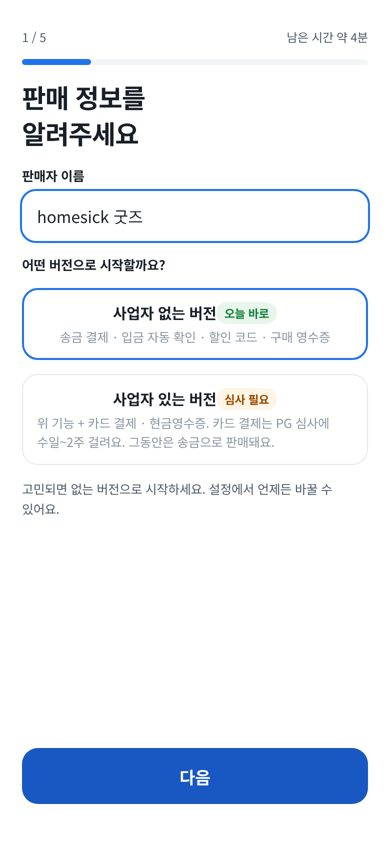
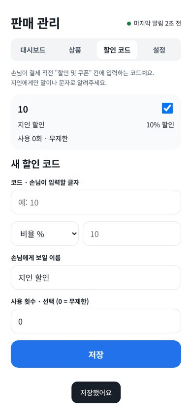
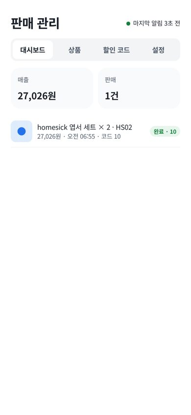
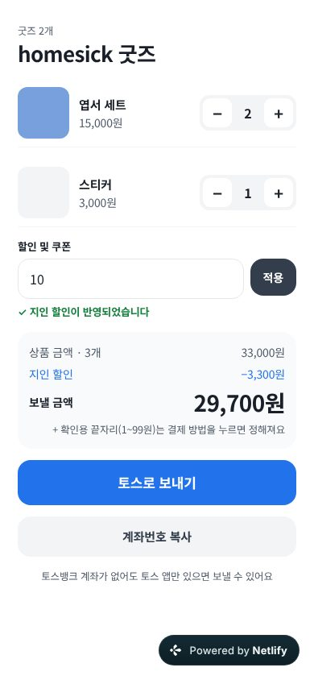
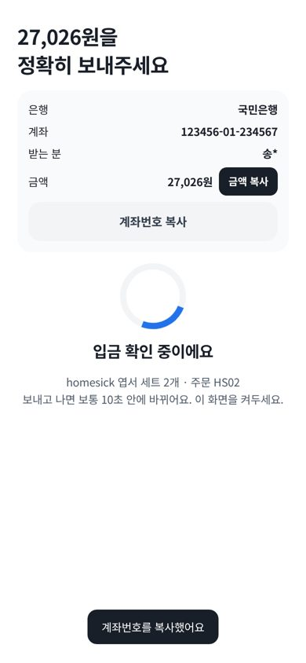
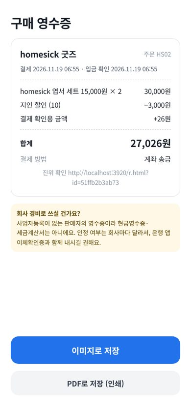

# 1인 굿즈 판매자를 위한 굿즈 결제시스템

사업자등록이나 PG 심사 없이, 지금 쓰는 계좌로 굿즈 값을 받는 결제시스템입니다.
판매자가 사진과 가격을 넣으면 QR이 만들어지고, 구매자는 QR을 찍어 토스·카카오페이·계좌이체로 보냅니다.
판매자 폰에 입금 알림이 오면 자동으로 확인돼 구매자 화면이 "결제 완료"로 바뀝니다.

- **5분 세팅**: 버전 선택 → 계좌 → 입금 알림 연결 → 첫 상품 → 테스트 결제
- **토스가 없어도 OK**: 토스·카카오페이 송금 링크, 어느 은행이든 계좌번호 복사
- **할인 코드**: 판매자가 만든 코드(예: `10`)를 구매자가 "할인 및 쿠폰"에 입력하면 "지인 할인이 반영되었습니다"
- **수량 조절**, **영수증 다운로드**(이미지·PDF), 사업자 판매자는 **현금영수증 신청**
- **사업자 없는 버전 / 있는 버전** 선택 (있는 버전은 카드결제용 PG 심사에 수일~2주가 걸린다고 미리 안내)

## 바로 눌러보기 (설치 없음)

`docs/` 폴더는 서버 없이 브라우저에서 돌아가는 데모입니다. 데이터는 그 브라우저에만 저장됩니다.

- 이 저장소의 **Settings → Pages → Branch: `main`, 폴더: `/docs`** 를 켜면 아래 주소로 열립니다.
  - 데모: `https://<아이디>.github.io/<저장소>/`
  - 발표 자료: `https://<아이디>.github.io/<저장소>/1%EC%9D%B8%20%EA%B5%BF%EC%A6%88%20%ED%8C%90%EB%A7%A4%EC%9E%90%EB%A5%BC%20%EC%9C%84%ED%95%9C%20%EA%B5%BF%EC%A6%88%20%EA%B2%B0%EC%A0%9C%EC%8B%9C%EC%8A%A4%ED%85%9C.html` (← → 키로 넘기기)
- 또는 내려받은 뒤 `docs/index.html`, `docs/1인 굿즈 판매자를 위한 굿즈 결제시스템.html`을 브라우저로 바로 열어도 됩니다.

**발표 자료 PDF 다운로드**: [1인 굿즈 판매자를 위한 굿즈 결제시스템.pdf](docs/1%EC%9D%B8%20%EA%B5%BF%EC%A6%88%20%ED%8C%90%EB%A7%A4%EC%9E%90%EB%A5%BC%20%EC%9C%84%ED%95%9C%20%EA%B5%BF%EC%A6%88%20%EA%B2%B0%EC%A0%9C%EC%8B%9C%EC%8A%A4%ED%85%9C.pdf) (가로 16:9, 24장) · 데모 화면 위쪽 바의 "PDF 받기"로도 받을 수 있어요.

데모 순서: 판매자 세팅 → 상품 탭 "결제 화면 보기" → 구매자 화면에서 수량·코드 입력 → 위쪽 검은 바 "판매자 폰에 입금 알림 보내기" → 결제 완료 → 영수증.

## 내려받아 실제로 쓰기

Node.js 18 이상만 있으면 됩니다. 설치할 패키지가 없습니다.

```bash
git clone https://github.com/<아이디>/<저장소>.git
cd <저장소>
node server.js            # http://localhost:3000 에서 판매자 세팅 시작
```

ZIP으로 받으려면 GitHub의 **Code → Download ZIP** 을 누른 뒤 압축을 풀고 같은 명령을 실행하세요.

| 설정 | 기본값 | 설명 |
|---|---|---|
| `PORT` | `3000` | 포트 |
| `DATA_DIR` | `./data` | 주문·상품 저장 위치 (`db.json`, 사진은 `uploads/`) |

구매자가 폰으로 QR을 찍으려면 서버가 인터넷에서 열려 있어야 합니다. 디스크가 유지되는 곳(Render, Railway, Fly.io, 집 PC + 터널 등)에 올리세요.

## 입금 자동 확인 연결

1. 세팅 3단계(또는 설정 탭)의 웹훅 주소를 복사합니다: `/api/deposit?token=...`
2. 안드로이드: MacroDroid 트리거 "알림 수신(토스·은행 앱)" → 액션 "HTTP 요청" POST, 본문 `{"text":"[notification_title] [notification_text]"}`
3. 아이폰: 단축어 자동화 "메시지(은행 번호)" → "URL 콘텐츠 가져오기" POST, JSON `text` = 메시지
4. 주문마다 금액에 1~99원 확인용 끝자리를 붙여 대기 주문과 금액으로 매칭합니다. 애매하면 대시보드의 "확인이 필요한 입금"에서 판매자가 연결합니다.

설정 탭의 "시험 알림 보내기"로 실제 송금 없이 흐름을 시연할 수 있습니다.

## 화면

| 판매자 · 버전 선택 | 판매자 · 첫 상품 | 판매자 · 상품 QR | 판매자 · 할인 코드 | 판매자 · 대시보드 |
|---|---|---|---|---|
|  |  |  |  |  |

| 구매자 · 결제 | 구매자 · 입금 확인 중 | 구매자 · 결제 완료 | 구매자 · 영수증 | 판매자 · 계좌 |
|---|---|---|---|---|
|  |  |  |  |  |

## 구성

| 경로 | 내용 |
|---|---|
| `server.js` | 의존성 없는 Node 서버 (API, 웹훅, 파일 저장) |
| `public/` | 실제 서비스 화면: 판매자 `/`, 구매자 `/p.html?id=상품ID`, 영수증 `/r.html?id=주문ID` |
| `docs/` | 설치 없는 데모(`demo-api.js`가 서버 대신 브라우저 저장소 사용)와 발표 자료 `1인 굿즈 판매자를 위한 굿즈 결제시스템.html` / `.pdf` |

## 아직 안 된 것

- 카드 결제(PG 연동): 사업자 버전에서 "연동 예정"으로 표시만 합니다.
- 현금영수증 자동 발행: 요청을 받아 대시보드에 보여주고, 판매자가 홈택스에서 발행 후 완료 처리합니다.
- 사업자 없는 버전의 구매 영수증은 적격증빙이 아니며, 영수증에 그렇게 표시됩니다.
