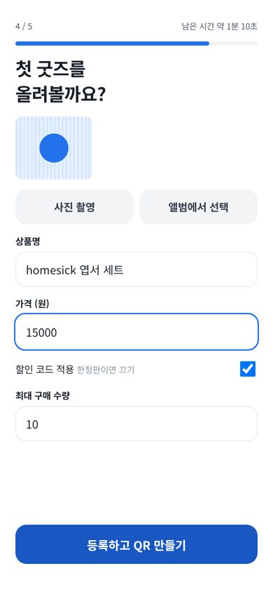
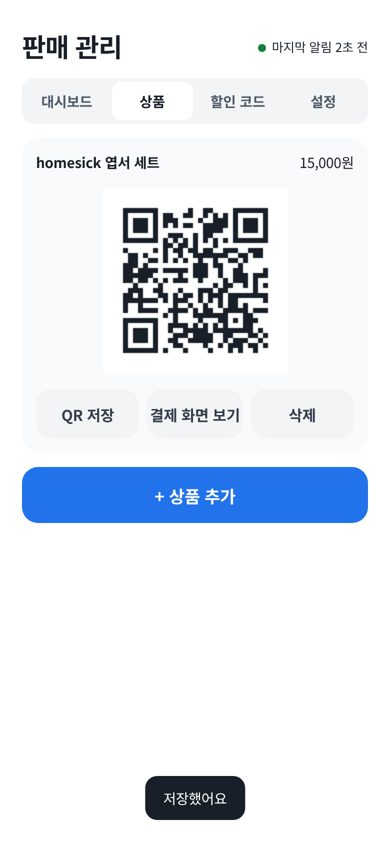
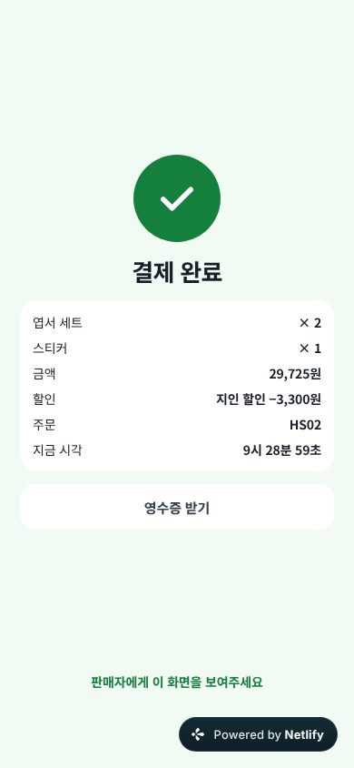
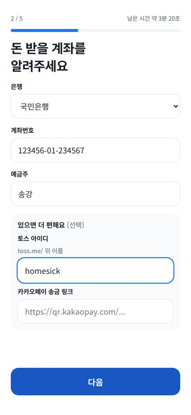

# 1인 굿즈 판매자를 위한 굿즈 결제시스템

사업자등록이나 PG 심사 없이, 지금 쓰는 계좌로 굿즈 값을 받는 결제시스템입니다.
판매자마다 **가게 QR 하나**가 생기고, 구매자는 QR을 찍어 굿즈를 골라 담은 뒤 토스·카카오페이·계좌이체로 한 번에 보냅니다.
손님이 송금한 뒤 "송금했어요"를 누르면 바로 "결제 완료"와 영수증이 뜨고, 판매자 매출 목록에 쌓입니다. 금액은 합계 그대로이며 끝자리를 더하지 않습니다.

**지금 써보기**: https://goods-pay-homesick.netlify.app (판매자 폰과 손님 폰이 실제로 연결되는 배포 버전, 판매자마다 각자 가게 생성)

- **3분 세팅**: 판매 정보·버전 → 계좌(은행 이름과 번호를 붙여넣어도 자동 정리) → 굿즈(사진 자르기 또는 이모지로 대체, 건너뛰기 가능)
- **가게 QR 하나**: 상품마다 QR이 아니라 가게당 하나. "크게 띄우기"(태블릿·폰 전체화면) 또는 "A4로 인쇄"
- **결합 할인**: 설정 > 쿠폰·할인에서 굿즈 2개 이상을 묶어 두면, 손님이 모두 담을 때 코드 없이 자동 할인 (코드와는 더 큰 할인 하나만 적용)
- **여러 굿즈 한 번에**: 손님이 굿즈별 수량을 골라 합계를 한 번에 송금
- **PC·휴대폰 화면 맞춤**: PC에서는 두 칸으로 넓게, 휴대폰에서는 한 줄로
- **토스가 없어도 OK**: 토스·카카오페이 송금 링크, 어느 은행이든 계좌번호 복사
- **할인 코드**: 판매자가 만든 코드(예: `10`)를 구매자가 "할인 및 쿠폰"에 입력하면 "지인 할인이 반영되었습니다"
- **영수증 다운로드**(이미지·PDF), 사업자 판매자는 **현금영수증 신청**
- **사업자 없는 버전 / 있는 버전** 선택 (있는 버전은 카드결제용 PG 심사에 수일~2주가 걸린다고 미리 안내)

## 발표용 데모 (설치 없음)

`docs/` 폴더는 서버 없이 브라우저에서 돌아가는 데모입니다(https://noromanticseoul.github.io/goods-pay/). 데이터는 그 브라우저에만 저장되므로 다른 폰에서 QR을 찍으면 열리지 않아요. 실제 판매는 위의 Netlify 주소를 쓰세요.

- 이 저장소의 **Settings → Pages → Branch: `main`, 폴더: `/docs`** 를 켜면 아래 주소로 열립니다.
  - 데모: `https://<아이디>.github.io/<저장소>/`
  - 발표 자료: `https://<아이디>.github.io/<저장소>/slides.html` (← → 키로 넘기기)
- 또는 내려받은 뒤 `docs/index.html`, `docs/1인 굿즈 판매자를 위한 굿즈 결제시스템.html`을 브라우저로 바로 열어도 됩니다.

**발표 자료 PDF 다운로드**: [1인 굿즈 판매자를 위한 굿즈 결제시스템.pdf](docs/slides.pdf) (가로 16:9, 11장 · 서비스 소개서) · 데모 화면 위쪽 바의 "PDF 받기"로도 받을 수 있어요.

데모 순서: 판매자 세팅 → 상품 탭 "손님 화면 보기" → 굿즈 수량·코드 입력 → 송금 방법 선택 → "송금했어요" → 결제 완료 → 영수증.

## 내려받아 실제로 쓰기

Node.js 18 이상만 있으면 됩니다. 로컬 서버(`node server.js`)는 설치할 패키지가 없습니다.

```bash
git clone https://github.com/<아이디>/<저장소>.git
cd <저장소>
node server.js            # http://localhost:3000 에서 판매자 세팅 시작
```

ZIP으로 받으려면 GitHub의 **Code → Download ZIP** 을 누른 뒤 압축을 풀고 같은 명령을 실행하세요.

| 설정 | 기본값 | 설명 |
|---|---|---|
| `PORT` | `3000` | 포트 |
| `DATA_DIR` | `./data` | 주문·상품 저장 위치 (`db.json`, 사진은 `uploads/`) |

구매자가 폰으로 QR을 찍으려면 서버가 인터넷에서 열려 있어야 합니다. 디스크가 유지되는 곳(Render, Railway, Fly.io, 집 PC + 터널 등)에 올리세요.

## Netlify에 배포하기 (폰끼리 실제 연결)

`netlify.toml`, `netlify/functions/api.mjs`가 들어 있어서 그대로 배포됩니다. 데이터는 Netlify Blobs에 가게별로 저장돼요.

1. Netlify → **Add new project → Import an existing project → GitHub** → 이 저장소 선택
2. 설정은 그대로 두고 Deploy (`publish = public`, 함수는 자동 인식)
3. 나온 주소로 들어가 판매자 세팅을 하면 끝. 다른 판매자도 같은 주소에서 자기 가게를 만들 수 있어요.

## 화면

| 판매자 · 버전 선택 | 판매자 · 첫 상품 | 판매자 · 가게 QR | 판매자 · 할인 코드 | 판매자 · 대시보드 |
|---|---|---|---|---|
|  |  |  |  |  |

| 구매자 · 굿즈 고르기 | 구매자 · 송금 안내 | 구매자 · 결제 완료 | 구매자 · 영수증 | 판매자 · 계좌 |
|---|---|---|---|---|
|  |  |  |  |  |

## 구성

| 경로 | 내용 |
|---|---|
| `core.js` | 공통 로직 (가게별 데이터, 장바구니 금액·할인, 금액 계산). 아래 셋이 함께 씀 |
| `server.js` | 로컬 서버, 의존성 없음 (`data/shops/가게ID.json`에 저장) |
| `netlify/functions/api.mjs` | 배포용 함수 (`/api/*`, `/uploads/*`, Netlify Blobs 저장) |
| `public/` | 화면: 판매자 `/`, 손님 `/p.html?s=가게ID`, 가게 QR `/qr.html?s=가게ID&mode=show\|print`, 영수증 `/r.html?s=가게ID&id=주문ID` |
| `docs/` | 설치 없는 데모(`demo-api.js`가 서버 대신 브라우저 저장소 사용)와 발표 자료 `1인 굿즈 판매자를 위한 굿즈 결제시스템.html` / `.pdf` |

## 아직 안 된 것

- 카드 결제(PG 연동): 사업자 버전에서 "연동 예정"으로 표시만 합니다.
- 현금영수증 자동 발행: 요청을 받아 대시보드에 보여주고, 판매자가 홈택스에서 발행 후 완료 처리합니다.
- 사업자 없는 버전의 구매 영수증은 적격증빙이 아니며, 영수증에 그렇게 표시됩니다.
